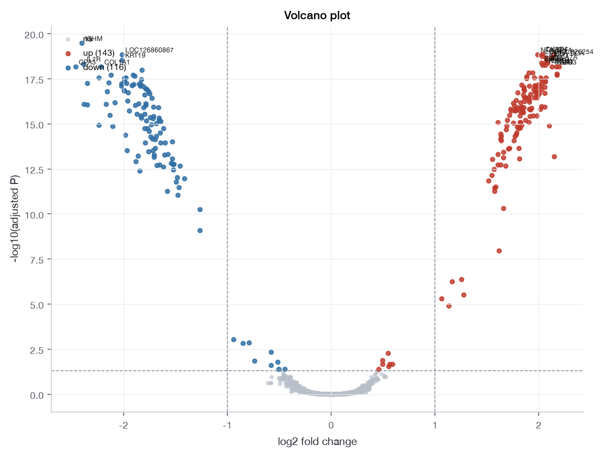
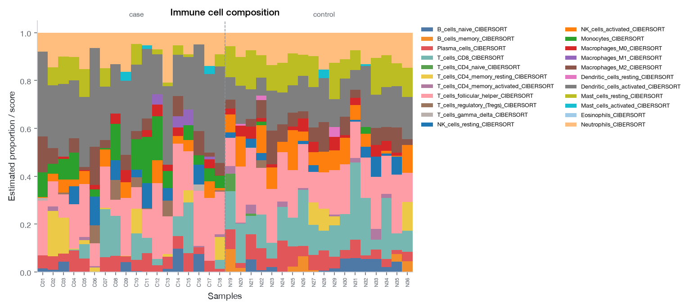
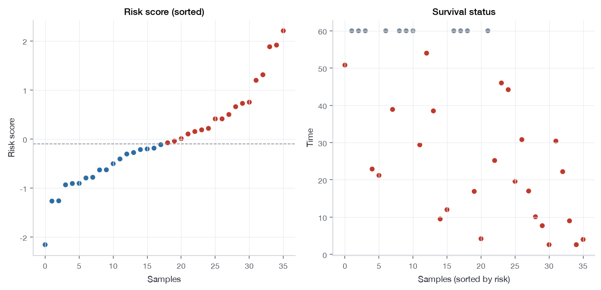

# dsh-geobulk · GEO / Bulk 转录组工作台

[](https://github.com/jszjdyt/dsh-geobulk/actions/workflows/ci.yml)
[](LICENSE)
[](https://github.com/deepseek-ai)

一个装在 **DeepSeek Harness** 里的 GEO / Bulk 转录组分析工作台：在浏览器里检索下载 GEO 表达谱、导入自己的测序矩阵、跑清洗与差异分析、做免疫浸润/生存/预后、把分子签名映射到单细胞亚群，并分析 circRNA / miRNA / lncRNA / fusion / 可变剪接。

界面形态与操作逻辑与姊妹项目 [`dsh-singlecell`](https://github.com/jszjdyt/dsh-singlecell)（单细胞工作台）一致：**左栏流程卡 → 中间图表 → 右栏 Agent 面板**；页面上的每个按钮和对话里的 `geobulk` 工具调用**走同一套实现**，所以「点着用」和「让 Agent 干活」结果完全一致。

> **English TL;DR** — A DeepSeek Harness plugin that puts a GEO/bulk transcriptomics workbench inside the chat UI: search & download GEO series, import your own count/TPM matrices with sample/clinical sheets, clean (QC → filter → normalize → batch correction → PCA), run limma/DESeq2 differential expression, GO/KEGG/Hallmark enrichment, IOBR immune deconvolution, Kaplan-Meier/Cox survival, prognostic risk models, project bulk signatures onto a single-cell reference (including pulling the active dataset straight from `dsh-singlecell`), and analyse circRNA/miRNA/lncRNA/fusion/alternative-splicing tables. Python engine + optional R bridge; everything degrades gracefully when R or the network is missing.



## 它解决什么问题

- GEO 数据检索**中文可搜、字段中文化**，结果可按物种 / 研究类型 / 样本量 / 有无临床信息筛选，选目录下载后一键导入清洗；
- 自己的 bulk 测序数据（counts / TPM / FPKM + 样本表 + 临床表）直接拖进来，和 GEO 数据走同一条分析流水线；
- 单数据集分析 + 多数据集合并去批次；
- 出图与出表：样本×基因表达表、差异可视化、功能富集、免疫浸润（尽可能全）、临床生存、高级预后；
- **最重要的一步：把 bulk 里找到的分子和签名映射回单细胞**——直接问"这个基因/这组差异基因在哪些细胞亚群表达"；
- 非编码与结构变异：circRNA、miRNA、lncRNA、fusion gene、可变剪接（rMATS / SUPPA 等结果表）。



## 功能一览

| 模块 | 内容 |
|---|---|
| **GEO 检索** | NCBI E-utilities 检索 GEO Series；192 条中英词典，**中文关键词自动翻译**并在结果过少时逐级放宽；可按物种、研究类型、最小样本数、是否有临床信息过滤 |
| **下载** | 解析 `matrix/` 与 `suppl/` 两个目录；**下载目录可指定**；断点重试、进度显示；下载后可直接导入并质控 |
| **数据导入** | 表达矩阵 `csv/tsv/txt/xlsx`（可 `.gz`）、GEO series matrix、`zip/tar.gz`、R 的 `.rds/.RData`（ExpressionSet / SummarizedExperiment / matrix）；样本信息表与临床表按样本名自动 join |
| **清洗** | 样本质控（文库大小/检出基因/离群）→ 低表达过滤 → 标准化（log2(CPM+1) / 分位数 / TMM / 中位数）→ **去批次**（ComBat 简化经验贝叶斯 / removeBatchEffect）→ PCA、样本相关性、层次聚类 |
| **差异表达** | **limma（R 官方）**默认，支持协变量与配对；DESeq2（需 counts）；Welch t 回退。火山图 / MA / 热图 |
| **功能富集** | ORA 超几何 + GSEA（加权 KS + 置换）；内置 GO（BP 95 / CC 59 / MF 74）、KEGG 115、Hallmark 49、Reactome 53，可接 Enrichr 在线库；ssGSEA/GSVA-lite 通路活性 |
| **免疫浸润** | **IOBR（R 官方）**：CIBERSORT / EPIC / MCP-counter / xCell / quanTIseq / ESTIMATE / ssGSEA / TIMER + IPS；组间差异、相关性、TME 分型；无 R 时 Python 回退并标注 |
| **临床生存** | 自动识别时间/事件列；KM + log-rank、单/多因素 Cox、最佳截断值扫描、时间依赖 ROC、亚组森林图、临床基线表 |
| **高级预后** | Cox / LASSO-Cox / RSF-lite 风险评分；风险图、分组 KM、时间 ROC、C-index、校准曲线、DCA、列线图数据 |
| **单细胞映射** | 选本机 h5ad，或**直接从 `dsh-singlecell` 工作台拉取当前数据集**；mean / AUCell / AddModuleScore 打分；细胞类型×得分表、目标分子在各亚群的平均表达/阳性率、亚群小提琴图、celltype×bulk 样本相关热图 |
| **非编码 / 结构变异** | **circRNA**（差异、背靠背比值、基因组圈图）；**miRNA**（名称规范化、差异、靶基因、ceRNA）；**lncRNA**（分类注释、差异、共表达网络）；**fusion**（STAR-Fusion / Arriba / 通用 gene1+gene2 解析，癌基因/激酶过滤、融合景观）；**可变剪接**（rMATS `IncLevel1/2` 或 PSI 矩阵，dPSI、火山图、事件类型、top 事件热图） |
| **导出** | 表达矩阵 / 差异表 / 富集表 / 免疫表 / 生存表 CSV、`summary_json`、`protocol`、英文 **Methods**、Markdown **报告**、可复现脚本 |
| **自检** | 确定性 audit（标准化状态、组间平衡、批次混杂、下游缺项…）给出 0–100 分与逐项建议 |
| **Agent 工具** | 单一 `geobulk` 工具覆盖 `status/search/detail/download/open/demo/inspect/preview/samples/run/plot/analyses/analysis/attach/export/audit/suggest/recipe/sc_refs/sc_attach/formats/reset` |



## 安装

### 前置依赖

- **Python ≥ 3.10**（本机验证 3.14）：`numpy pandas scipy scikit-learn matplotlib anndata h5py lifelines statsmodels openpyxl pillow networkx`
- **R ≥ 4.2（可选但强烈建议）**：`limma edgeR DESeq2 clusterProfiler DOSE fgsea msigdbr GSVA WGCNA preprocessCore ComplexHeatmap timeROC rms glmnet survminer org.Hs.eg.db IOBR`
  - 没有 R 时插件自动回退到内置 Python 实现（limma→Welch+BH、clusterProfiler→超几何、GSVA→ssGSEA、IOBR→内置签名打分），结果会标注 `lite`。

```bash
python3 -m pip install -r requirements.txt
# 可选：检查 R 侧依赖
Rscript -e 'for (p in c("limma","DESeq2","clusterProfiler","fgsea","GSVA","IOBR")) cat(p, requireNamespace(p, quietly=TRUE), "\n")'
```

### 装进 DeepSeek Harness

```bash
git clone https://github.com/jszjdyt/dsh-geobulk.git
cd dsh-geobulk
```

然后在 Harness 里（设置 → 插件 → 安装本地插件包，选择这个目录），或让 Agent 执行：

```text
plugin_manager  action=install_bundle  target=<克隆目录的绝对路径>
```

安装完成后**刷新一次页面**：左侧边栏出现「Bulk 工作台」，对话里出现 `geobulk` 工具。

> 这是 Host + Client 双半页插件：Host 提供 `/geobulk/*` 路由与 `geobulk` 工具，Client 注册整页与侧边栏入口。安装细节见 [INSTALL.md](INSTALL.md)。

## 快速开始

1. 打开侧边栏「Bulk 工作台」→ 顶栏点「载入示例数据」（36 样本 × 4000 基因，含分组/批次/临床列）。
2. 左栏从上到下点「运行」：质控 → 过滤 → 标准化 → 降维 → 差异 → 富集 → 免疫 → 生存 → 预后。
3. 「单细胞」tab 指定 h5ad（或直接从单细胞工作台拉取）→ 跑单细胞映射。
4. 「记录」tab 导出报告 / Methods / 复现脚本。

用真实数据：

- **GEO**：顶栏「GEO 检索」→ 输入中文或英文关键词（如 `胃癌 顺铂 耐药 表达谱`）→ 点结果卡片看详情 → 填下载目录 → 下载 → 「导入并清洗」。
- **自有数据**：「导入数据」→ 选表达矩阵 + 样本信息表 + 临床表；或让 Agent：`geobulk action=open path=/data/counts.csv sample_sheet=/data/samples.csv clinical=/data/clinical.csv`。

## 让 Agent 干活

页面所有能力都能用一句话驱动，例如：

- 「在 GEO 搜胃癌顺铂耐药表达谱，挑有临床信息的，下到 `~/data/GEO`，导入后做质控和差异」
- 「用 OS 做生存分析，按中位 cutoff 把 CD8A 分高低组出 KM，再看多因素 Cox」
- 「把差异基因映射到我单细胞工作台当前的数据集，看是哪些亚群在表达」
- 「导入我的 counts 矩阵和样本表，标准化后去批次再做差异和 KEGG 富集」
- 「挂上 STAR-Fusion 结果，筛癌基因/激酶融合，出融合景观图」

Agent 返回的图是绝对路径，可以直接用 `read_image` 查看。

## 工作台流程（左栏 12 张卡）

```
qc → filter → normalize → batch → pca → de → enrich → immune → survival → prognosis → scmap → ncrna
```

- 每步可改参数、可重跑；重跑会清空下游结果（历史保留）；
- 缺前置会给中文可读原因，不会静默造结果；
- 图与表随步骤返回，「记录」tab 汇总历史 + 自检 + 导出；
- 70 项高级分析按 `基本分析 / 差异分析 / 通路分析 / 免疫浸润 / 临床生存 / 高级预后 / 单细胞 / 非编码` 分组，按前置条件自动置灰。

## 架构

```
dsh-geobulk/
├── index.js                 # Host 入口：/geobulk 路由 + geobulk 工具 + prompt section
├── client.js                # 浏览器整页 UI（纯函数层可 node 测试）
├── lib/
│   ├── impl.mjs             # HTTP 与工具的唯一实现（含异步任务、单细胞联动）
│   ├── engine.mjs           # Python worker 管理（探测/队列/超时/重启）
│   ├── bg_engine.py         # Python worker 主循环（JSON-lines over stdio）
│   ├── bg_registry.py       # 步骤/分析注册、ctx 构造、调度、导出、自检
│   ├── bg_state.py          # 数据集状态 + 内置示例数据
│   ├── bg_common.py         # 结果信封 / 绘图 / 统计工具
│   ├── rbridge.py           # Rscript 桥（bundle 传入、表格/图读回）
│   ├── bg_io.py             # 12 种格式导入
│   ├── bg_geo.py            # GEO 检索/详情/下载（含中文翻译与放宽）
│   ├── bg_prep.py           # qc / filter / normalize / batch / pca
│   ├── bg_de.py  + bg_de.R  # limma / DESeq2 差异表达
│   ├── bg_enrich.py         # ORA / GSEA / 通路活性
│   ├── bg_genesets.py       # 内置基因集 + Enrichr 缓存
│   ├── bg_immune.py + .R    # IOBR 免疫浸润 + Python 回退
│   ├── bg_survival.py       # KM / Cox / cutoff / 时间 ROC
│   ├── bg_prognosis.py      # 风险模型 / 校准 / DCA / 列线图数据
│   ├── bg_scmap.py          # 单细胞签名映射
│   ├── bg_ncrna.py          # circ/miRNA/lncRNA/fusion/剪接
│   └── bg_plots.py          # 通用出图端点
├── test/                    # 单测 + fixtures + 端到端验收
├── examples/                # 示例产物（图 + 报告）
├── DESIGN.md                # 内部契约（协议、模块 API、扩展方式）
└── .github/workflows/ci.yml # CI：语法 + 单测（不需要 R）
```

数据流：浏览器 `<fetch>` → `/geobulk/*` → `lib/impl.mjs` → Python worker（JSON-lines）→ 模块 → 结果信封（summary/tables/figures）→ UI 渲染。Agent 走 `geobulk` 工具 → 同一个 `runTool` → 同一套 `op*` 函数。

## 测试

```bash
# 端到端验收（demo 全流程，需要本地 Python + 可选 R）
python3 test/py_acceptance.py          # 40/40 PASS

# 单测
python3 test/py_geo_test.py            # GEO 解析（离线 mock）94 checks
python3 test/py_scmap_test.py          # 单细胞映射 70/70
node test/client-logic.test.mjs        # UI 纯函数 31
node test/client-render.test.mjs       # 组件渲染烟测（19 renders / 26 components）
node test/host_ops.test.mjs            # Host 层联调 34
```

CI 在 GitHub Actions 上跑语法检查 + 不依赖 R 的单测（见 `.github/workflows/ci.yml`）。

## 已知限制（诚实标注）

- 富集使用**内置精选基因集 + Enrichr 在线缓存**，不是完整 MSigDB；需要全库可换 Enrichr 库名。
- 免疫浸润在基因数偏少的数据上会跳过部分方法（xCell 需 ≥520 基因重叠、quanTIseq 需特定基因），会写 warning 并继续。
- 本环境无 `sksurv`，随机生存森林用 **bootstrap Cox 集成（RSF-lite）** 近似；时间依赖 ROC 为「按时间点二分类 + 删失排除」近似。
- fusion 与可变剪接是**下游分析**：读取 STAR-Fusion / Arriba / rMATS / SUPPA 等结果表，不做上游 calling / 定量。
- 自有数据是**矩阵级**入口；本插件不做 FASTQ→counts（未捆绑比对工具）。
- 单细胞映射需要 h5ad 参考；细胞类型来自参考自身注释，不会改写参考数据。

## 数据与合规

- GEO 数据的使用请遵守 NCBI GEO 的使用条款与各数据集原始发表文献的许可。
- 本插件是分析工具，输出结果（差异、预后模型等）**不构成临床或医学建议**；预后模型须外部验证。
- 内置示例数据为程序合成，不对应任何真实患者。

## 关系与致谢

- 姊妹项目：[`dsh-singlecell`](https://github.com/jszjdyt/dsh-singlecell)（单细胞工作台），本插件的 UI 形态、宿主集成方式与工程约定与其一致，并可与之联动。
- 方法学依赖：limma、DESeq2、clusterProfiler、fgsea、GSVA、WGCNA、timeROC、rms、glmnet、survminer、**IOBR**（免疫浸润）、lifelines、scikit-learn、matplotlib。
- 干运行环境：DeepSeek Harness（Host 插件体系）。

## License

[MIT](LICENSE)
